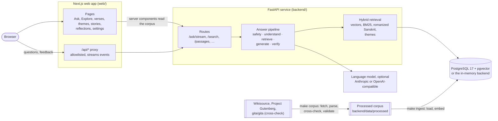
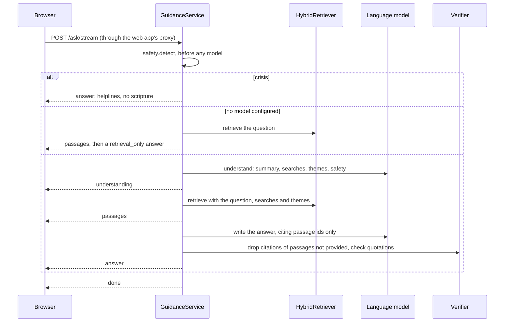

# Architecture



- **The browser only talks to the web app.** Pages are rendered on the server, which reads the corpus from the API; questions and feedback go through the web app's same-origin `/api/*` proxy.
- **The API owns everything else**: safety, retrieval, generation, verification and storage. It works without a language model, and without PostgreSQL (`RETRIEVAL_BACKEND=memory` serves the processed corpus from disk).
- **The corpus is built offline** by an ingestion pipeline, and the result is committed:

```
fetch (cached, checksummed) → parse → cross-check → validate → data/processed/ → load into Postgres
```

The pipeline is covered in [DATA.md](DATA.md). This document describes the running system.

## Design principles

- **The model never supplies scripture.** It returns passage ids. The app displays the stored Sanskrit, transliteration and translation for those ids, so a model cannot misquote a verse that the app shows.
- **Everything the model cites must have been retrieved for it.** A verifier enforces this on every answer.
- **Source, commentary, editorial material and AI interpretation are always distinguishable.** Each has its own label in the API and the UI.
- **Fail safe and fail visible.**
  - Crisis detection runs before, and independently of, any model.
  - If the model is missing or fails, the user still gets verified passages, with a plain notice that no guidance was generated.
- **No vendor lock-in.** The model provider, the embedding provider and the storage backend are all configuration.

## The answer pipeline

`POST /ask/stream` (and its non-streaming twin `POST /ask`) is implemented by `GuidanceService.stream` in `backend/app/generation/service.py`.



The steps in detail:

1. **Deterministic safety check** (`safety.detect`). Regular expressions for self-harm, abuse and violence in English, Hindi and Hinglish. A crisis match returns a crisis answer at once, with helplines and without scripture. See [SAFETY.md](SAFETY.md).
2. **No model configured?** Hybrid retrieval runs on the question alone, and the answer is `retrieval_only`: verified passages plus a notice.
3. **Understand** (model step 1, structured output `Understanding`). The model returns:
   - the person's language;
   - the request type: `life_situation`, `follow_up`, `scripture_question` or `out_of_scope`;
   - a situation summary, the core dilemma and the emotions;
   - up to 5 search queries and up to 4 concept ids from the editorial index;
   - a safety assessment;
   - an optional clarifying question.

   The model's safety assessment can raise the safety level but never lower it. A model-only "crisis" also needs a crisis category (suicide, abuse, violence or medical); otherwise it counts as "concern".
4. **Gates:**
   - a crisis, from either check, gets the crisis answer;
   - `out_of_scope` gets a short message in the person's language;
   - a clarifying question is returned on its own only for a first message of under 12 words. Anything longer gets a full answer, in which the model can still ask what it needs to know.
5. **Retrieve.** Hybrid retrieval (below) runs with the raw question, the model's queries and concepts, and the passages cited in the previous answer, which lets follow-ups refer back to them. When the safety categories indicate risk, passages marked `exclude_in_crisis` are removed.
6. **Generate** (model step 2, structured output `GuidanceDraft`).
   - The prompt (`prompts.ANSWER_SYSTEM`) carries the grounding rules. The passages arrive as XML with their ids, translator, context notes and sensitivity notes.
   - The model writes answer parts A–G and refers to passages inline as `[[bg.2.47]]`.
7. **Verify** (`verify.Verifier`). The verifier makes these changes:
   - It drops teachings and related passages whose id was not provided.
   - It removes `[[id]]` markers for passages that were not provided.
   - It removes quotation marks from any quoted wording that does not appear verbatim in a provided translation. The words stay, now as the model's own phrasing.
   - It caps the counts: 4 teachings, 6 steps, 3 related passages and 3 follow-ups.
   - If no usable teaching remains, the answer becomes `insufficient_sources`.

   Every change is reported in the answer's `verification.issues`.
8. **Assemble.** The service builds the `AnswerView`, with `references` that map each cited id to its page, for rendering `[[id]]` markers as links.

If either model call fails, the stream emits an `error` event and falls back to a `retrieval_only` answer. Malformed or truncated structured output is retried once.

The stream's events are `status` (`understanding`, `retrieving`, `writing`), `understanding`, `passages`, `answer`, `error` and `done`. The full format is in [API.md](API.md).

## Retrieval

`HybridRetriever` (`backend/app/retrieval/hybrid.py`) fuses several ranked lists with reciprocal rank fusion. Each list contributes `weight / (k + rank)` to a passage's score, with `k = 30` (`RRF_K`).

| Channel | What it matches | Weight |
| --- | --- | --- |
| `vector` | Cosine similarity between query and passage embeddings, one list per query | 1.0 for the model's queries, 0.25 for the raw question (`RETRIEVAL_RAW_VECTOR_WEIGHT`) |
| `lexical` | BM25 over the English search text (`storage/lexical.py`), the same index on both backends: the translation is one field; translator's notes, chapter title and concept vocabulary are another, at 0.4 | 1.0 |
| `roman` | Trigram `word_similarity` of the question against romanized Sanskrit, so `karmanye vadhikaraste` finds 2.47 | 4.0 |
| `concept_llm` | Passages of the concepts the model chose | 2.0 |
| `concept_semantic` | Passages of concepts whose description embeds close to the question (cosine ≥ 0.80) | 1.0 |
| `pinned` | Passages cited in the previous answer (follow-ups) | 3.0 |

After fusion:

- **Speaker prior.** A mild prior favours the teaching over the narrative frame: Krishna 1.0, Arjuna 0.8, Sanjaya 0.65, Dhritarashtra 0.5. It is a preference, not a filter.
- **Adjacency.** A verse adjacent to one already selected becomes that verse's context instead of taking its own slot, which keeps results diverse. Each result carries ±1 neighbouring verses as context.
- **Evidence.** `assess_evidence` labels each result set:
  - **strong:** a romanized-Sanskrit match, a concept chosen by the model, or concept similarity of at least 0.83;
  - **moderate:** concept similarity of at least 0.80, or at least two top-5 passages found by more than one channel, provided the question is semantically close to some passage (raw-question vector similarity of at least 0.825). Without that condition, shared words alone ("rain", "moon", "won") made unrelated questions look answered;
  - **weak:** otherwise.

  Without a model, the label is what tells a reader that the texts may not address the question: "weak" becomes "limited" evidence in Ask and a note in Explore. With a model, the understanding step recognises out-of-scope questions itself, and the answer prompt asks the model to judge relevance. The label is a hint, not a guarantee; see [EVALUATION.md](EVALUATION.md#confidence-and-abstention).

**Query processing** (`retrieval/text.py`):

- stopwords, including archaic English ("thou", "hath");
- a small synonym map from modern to translation vocabulary (anxious → anxiety, fear, troubled; boss → example, standard, welfare);
- a Hindi/Hinglish → English keyword map, so a Hindi question also searches the English translation;
- Snowball stemming;
- a loose romanization key for Sanskrit.

**Embeddings.** The default is `intfloat/multilingual-e5-small`, run in-process with ONNX through fastembed. It is 384-dimensional, needs no API key and handles Hindi. An OpenAI-compatible embeddings endpoint can be used instead. Concept-similarity thresholds are specific to the model; re-tune them if you change models (see [EVALUATION.md](EVALUATION.md)).

**Backends.**

- `postgres` uses pgvector for exact cosine search. With 872 passages an index is not needed; add HNSW once the corpus grows past roughly 50k passages.
  - **Lexical search:** it builds the shared BM25 index from the stored search text on first use, and rebuilds it when the passages change. It checks at most every 30 seconds, so after `make ingest` the API searches the new text within 30 seconds.
  - **Fuzzy Sanskrit:** it uses `pg_trgm`.
  - **Unused for ranking:** the generated `tsvector` column and its index remain, but nothing ranks by them any more. `ts_rank_cd` gives a common word as much weight as a rare one and ignores length, and it found fewer expected passages ([EVALUATION.md](EVALUATION.md#the-postgresql-gap)).
- `memory` implements the same `Repository` protocol with the same BM25 index, numpy and trigram containment. Tests, the evaluation and Docker-free development use it.
- **Lexical results are identical on both backends.** Vector results can differ slightly: PostgreSQL's stored embeddings were computed in other batches, and the model's output depends a little on batch composition.

## Model providers

Both providers implement `LLMClient.structured(system, user, schema, step)` (`backend/app/generation/llm.py`). It returns a validated Pydantic object or raises a typed error: `llm_not_configured`, `llm_unavailable`, `llm_request_rejected`, `llm_refused` or `llm_bad_output`.

- **Anthropic** (`providers/anthropic_provider.py`) uses Messages API structured outputs (`client.beta.messages.parse` with the Pydantic schema).
  - Effort is set per step: `low` for understanding, `medium` for the answer.
  - The long system prompts are marked for prompt caching.
  - Refusals and `max_tokens` stops are handled explicitly.
  - With `LLM_REFUSAL_FALLBACKS=true`, a safety-classifier refusal is retried server-side on Anthropic's recommended fallback model.
- **OpenAI-compatible** (`providers/openai_compatible.py`) works with OpenAI, OpenRouter, Groq, vLLM and Ollama.
  - It uses a strict JSON schema, or JSON mode plus validation for servers without schema support (`LLM_JSON_MODE`).
  - It makes one repair attempt when the output fails validation.
  - It strips `<think>` blocks from reasoning models.

Missing credentials never crash the API. `/health` reports `llm.configured: false` with the reason, and `/ask` returns a `retrieval_only` answer that says so.

## Storage

`backend/migrations/` holds the schema. Migrations are applied in order and tracked in `schema_migrations`.

| Table | Contents |
| --- | --- |
| `sources`, `editions` | Source metadata (divisions, labels) and editions (translator, licence, URL). One edition can cover several sources. |
| `passages` | One row per verse: the full passage JSON plus search columns (the English search text that the BM25 index is built from, a weighted `tsvector` no longer used for ranking, the romanized key) and a content hash |
| `passage_embeddings` | One vector per passage and model, with the hash of the embedded text, so only changed text is re-embedded |
| `concepts`, `concept_passages`, `concept_embeddings` | The editorial theme index |
| `stories` | Editorial story records |
| `feedback` | Reports from users. There is no question text unless the person explicitly shared it. |

`python -m app.ingestion load` is idempotent: it upserts changed rows, deletes rows that no longer exist and re-embeds only changed text. The API container runs it on start.

## Web app

The web app uses Next.js 16 (App Router, Turbopack) with React 19 and Tailwind CSS 4.

- **Rendering.** Cache Components (`cacheComponents: true`) are enabled.
  - Corpus reads are `'use cache'` functions with `cacheLife` (`web/src/lib/api.ts`).
  - Pages prerender a static shell and stream the data. The production build therefore does not need the API.
- **Real 404s.** A streamed page has already sent `200` by the time it finds that a record does not exist. `web/src/proxy.ts` checks verse, theme and story paths against a cached index first, and rewrites unknown ones to a real `404`.
- **Browser → API.** The browser only ever calls `/api/*`, an allowlisted, same-origin proxy route (`web/src/app/api/[...path]/route.ts`). It streams server-sent events through unchanged, and it forwards the client address for rate limiting (see [DEPLOYMENT.md](DEPLOYMENT.md)).
- **Ask** (`components/ask/`) is a client component that consumes the event stream. It has two views at one address: the invitation, and the conversation (`/#conversation`), so refresh and back/forward keep the view, and links to Ask return to the invitation without losing the conversation. The conversation lives in `sessionStorage` and is gone when the tab closes. Saved reflections live in `localStorage`, and can be exported as Markdown or deleted.
- **Design system.** Colours, shadows and widths are CSS custom properties in `web/src/app/globals.css`: an ivory-and-ink light palette and a charcoal-ink dark palette, with a saffron accent, mapped to Tailwind utilities. Shared building blocks live in `components/layout/` (page frame, header, breadcrumbs, empty and loading states) and `lib/ui.ts` (button and link recipes). Verified source text always carries the same seal mark (`SourceSeal`).
- **Appearance.** Settings offers System (the default, following the device), Light and Dark, stored in `localStorage`. An inline script in `<head>` applies the choice before the first paint; `ThemeSync` follows the device while System is selected. Details are in `web/README.md`.
- **Scene.** Ask and Explore sit on a decorative full-screen stage: an observatory, an armillary sphere resting in an engraved bowl after Jaipur's Jantar Mantar, drawn with three.js through React Three Fiber (`web/src/components/scene/`).
  - It first paints as a still SVG drawing in the server HTML.
  - The 3D chunk loads when the browser is idle, and only where WebGL exists.
  - The Ask page is a scroll story in five chapters (invitation, teachings, themes, understanding, return); the instrument takes a pose for each, read from the scroll position, never moving the page.
  - It follows the conversation: thinking, then reading. It keeps still for reduced motion, renders less on low-power devices, draws nothing in a background tab, and fades out for a crisis reply.
  - Content elsewhere moves into place with CSS scroll-driven animations; text is moved, never faded.
  - Details are in `web/README.md`.
- **Typography.**
  - Instrument Serif for headlines and pull quotes.
  - Literata for scripture in translation, chosen because it covers the IAST diacritics.
  - Tiro Devanagari Sanskrit for Sanskrit.
  - Geist for the interface and for model-written text, so interpretation never looks like scripture.
- **Accessibility:**
  - skip link, landmarks and labelled controls;
  - visible focus;
  - `lang="sa"` on Sanskrit;
  - support for `prefers-reduced-motion`;
  - text contrast that meets WCAG AA in both themes.

  Axe checks run on 12 pages, in both themes, in the end-to-end suite.

## Extending

- **Another source:** write an adapter in `backend/app/ingestion/sources/` and register it in `pipeline.build_corpus`. See [DATA.md](DATA.md#adding-a-source).
- **Another model provider:** implement `LLMClient` and add it to `create_llm`.
- **Another embedding model:** set `EMBEDDING_MODEL` and run `make ingest`. Re-check the concept thresholds with `make eval`, and add the model's query/passage prefixes to `embeddings.prefixes_for` if it needs them.
- **A reranker:** add it after fusion in `HybridRetriever.retrieve`, over the top 20–30 candidates. One has been measured, always and only for uncertain questions (`python -m app.evaluation.experiments rerank`). It improved ordering but not recall, at about 1.2 s per question and 1 GB of memory, so it is not used; see [EVALUATION.md](EVALUATION.md#conditional-reranking).
